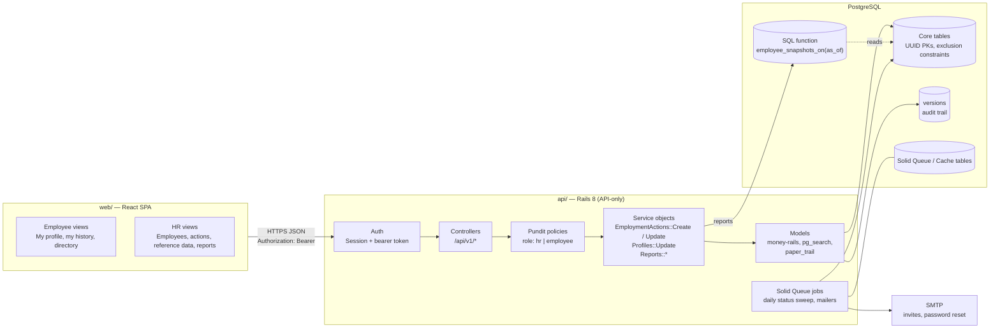
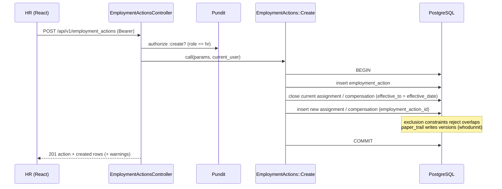

# Architecture

## System overview

## Request flow: employment action (for example, a promotion)

## Layer responsibilities

| Layer | Responsibility | Must not |
|---|---|---|
| Controllers | Parse params, `authorize`, call a service, render JSON | Hold business rules or write multiple tables |
| Policies (Pundit) | Role checks; per-field permits for profile (`employee` vs `hr`) | Query beyond the record and `current_user` |
| Services | Transactions across tables: actions, nested profile save, reports | Render responses |
| Models | Validations, associations, `monetize`, scopes, search | Cross-aggregate writes |
| SQL views | Point-in-time joins for reporting and employee lists | Be written to |
| Jobs | Daily `on_notice → separated` sweep, emails | Run user-triggered business logic synchronously |

## Key technology choices

| Concern | Choice |
|---|---|
| API framework | Rails 8, `--api` mode |
| Database | PostgreSQL (`pgcrypto` for UUIDs, `btree_gist` for exclusion constraints, `pg_trgm` for search) |
| Auth | Rails 8 authentication generator, adapted for bearer tokens |
| Authorization | Pundit |
| Money | `money-rails` (amount in cents plus currency) |
| Audit | `paper_trail` |
| Search | Postgres full-text (`tsvector`) plus `pg_trgm` similarity, done in SQL by `EmployeeSearch`. `pg_search` provides `Person.search`. |
| Employee list / reporting | SQL function `employee_snapshots_on(as_of)` (inlined by Postgres), read through `EmployeeSnapshot` |
| Background jobs | Solid Queue |
| CORS | `rack-cors`, which allows the React origin |
| Frontend | React SPA in `web/` |
