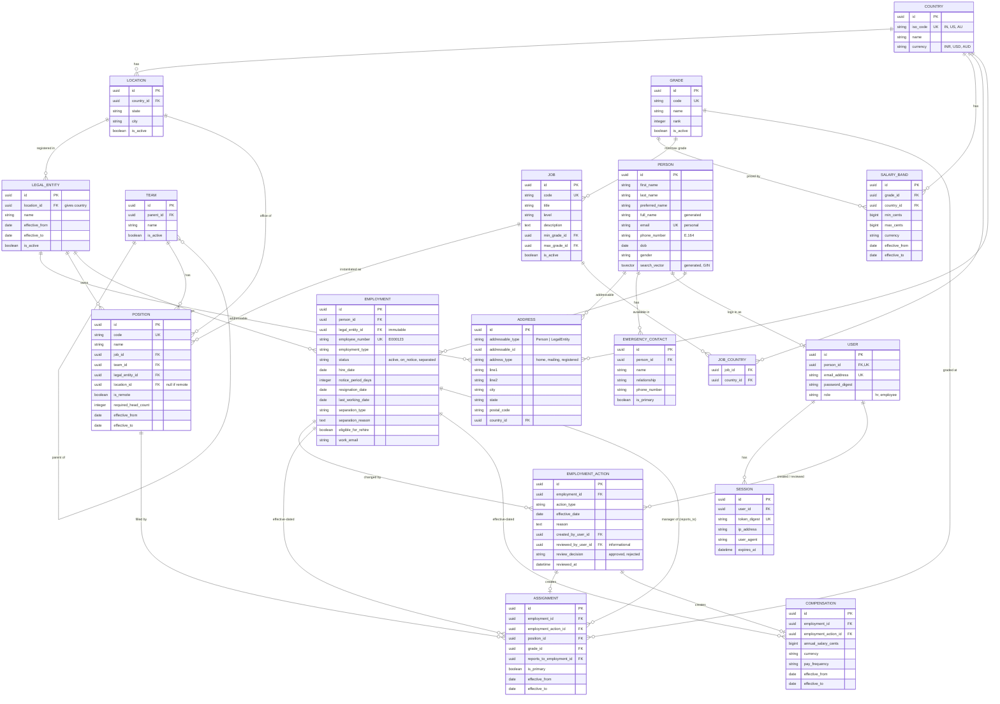
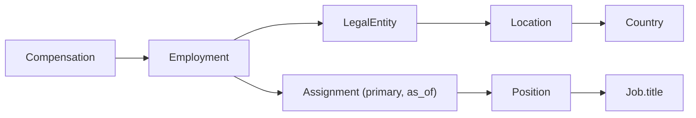

# ER Diagram

Source of truth for column meanings and rules: [domain-model.md](domain-model.md).
All PKs are UUIDs. `lock_version` and timestamps are omitted from the diagram for readability.

## Reporting path

